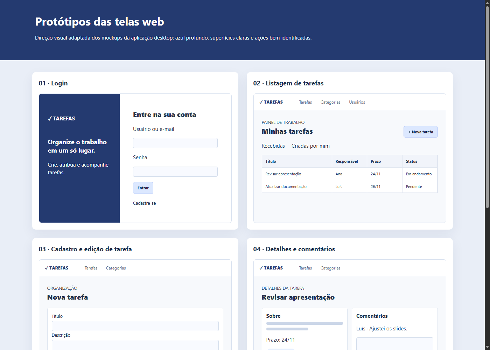

# Gerenciador de Tarefas Web

Sistema acadêmico em **Java 17, Spring Boot, Spring MVC, Thymeleaf, Spring Data JPA, Spring Security e SQL Server**. Este projeto fica em uma pasta e repositório próprios, separados da aplicação desktop Swing. Reutiliza as tabelas `usuarios`, `tarefas`, `categorias` e `comentarios_tarefa`.

## Entrega da 1ª etapa

- **Tema:** cadastro, atribuição e gerenciamento de tarefas.
- **Protótipos de tela:** [abrir galeria HTML](docs/prototipos/index.html).
- **Diagrama de classes UML e MER:** [abrir modelagem com Mermaid](docs/modelagem.md).



## Funcionalidades

- Login por usuário ou e-mail e cadastro de conta; senhas compatíveis com o hash PBKDF2 da versão desktop.
- CRUD de tarefas, categorias e comentários.
- Cadastro e listagem de usuários; cada pessoa pode editar/excluir sua própria conta, respeitando os vínculos do banco.
- Listagem de tarefas criadas e recebidas, atribuição, prioridade, prazo, categoria e mudança de status.
- Logout e proteção de rotas e formulários pelo Spring Security.

## Arquitetura MVC

`model` contém as entidades JPA; `repository` contém as interfaces Spring Data; `service` concentra regras e permissões; `controller` recebe requisições e chama **somente os serviços**; `templates` e `static` formam a camada View. `spring.jpa.hibernate.ddl-auto=validate` valida o esquema existente e não altera tabelas.

## Banco e execução

É necessário ter Java 17+ e o banco SQL Server `GerenciamentoTarefas` já criado com as quatro tabelas. O Maven Wrapper (`mvnw.cmd`) baixa o Maven automaticamente na primeira execução. Configure as variáveis de ambiente sem salvar a senha no repositório:

```powershell
$env:TAREFAS_DB_URL = 'jdbc:sqlserver://127.0.0.1:1433;databaseName=GerenciamentoTarefas;encrypt=true;trustServerCertificate=true'
$env:TAREFAS_DB_USER = 'seu_usuario_sql'
$env:TAREFAS_DB_PASSWORD = 'sua_senha_sql'
.\mvnw.cmd spring-boot:run
```

Abra `http://localhost:8080`. O SQL Server deve aceitar autenticação SQL e conexões TCP/IP. Para entregar a outra pessoa, ela precisará de um banco com o mesmo esquema e de credenciais próprias.

## Testes

```powershell
.\mvnw.cmd test
```

## GitHub

Repositório destinado a este projeto: **adicione aqui a URL após criar e publicar o repositório no GitHub**. Nenhuma credencial ou arquivo `target/` deve ser versionado.
