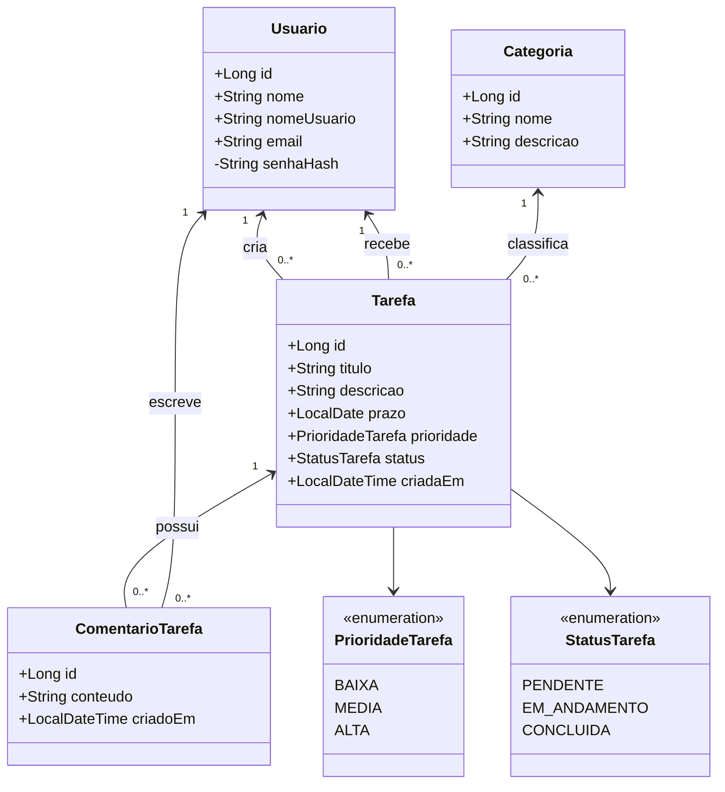
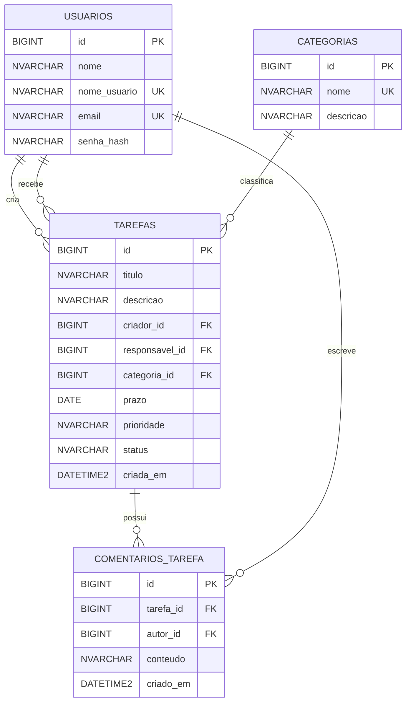

# Modelagem do Gerenciador de Tarefas Web

## Tema e suposições

Sistema web para criar, atribuir e acompanhar tarefas. Reutiliza as quatro tabelas do banco SQL Server da aplicação desktop. Uma tarefa possui exatamente um criador, um responsável e uma categoria. Comentários pertencem a uma tarefa e a um autor. Status e prioridade são enumerações armazenadas na tabela `tarefas`.

Para o CRUD web, usuários podem editar ou excluir **a própria conta**; uma conta vinculada a tarefas ou comentários não pode ser excluída. O criador edita/exclui sua tarefa, o responsável altera o status, e somente o autor edita/exclui seu comentário. Usuários autenticados gerenciam categorias; `Geral` e categorias em uso não podem ser excluídas.

## Protótipos

Veja a [galeria de protótipos web](prototipos/index.html): login, listagem, formulário de tarefa, detalhes/comentários, categorias e usuários. As páginas Thymeleaf implementam as mesmas estruturas em `src/main/resources/templates`.

## Diagrama de classes

As quatro classes persistentes são entidades JPA. `UsuarioRepository`, `TarefaRepository`, `CategoriaRepository` e `ComentarioRepository` implementam persistência via Spring Data; serviços concentram validação e permissões; controllers HTTP chamam somente serviços.

## Diagrama MER

O banco conserva as restrições `NOT NULL`, `UNIQUE`, `CHECK` de status/prioridade e as chaves estrangeiras da versão desktop. A exclusão de tarefa remove seus comentários por cascata no banco existente.

## Coerência entre telas, classes e tabelas

| Tela | Operação | Entidade/Tabela |
|---|---|---|
| Login/cadastro/usuários | autenticar, criar, listar, editar e excluir a própria conta | `Usuario` / `usuarios` |
| Tarefas | criar, listar recebidas/criadas, editar e excluir | `Tarefa` / `tarefas` |
| Categorias | criar, listar, editar e excluir | `Categoria` / `categorias` |
| Detalhes/comentários | criar, listar, editar e excluir comentários | `ComentarioTarefa` / `comentarios_tarefa` |
